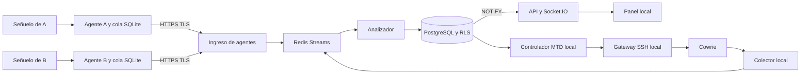
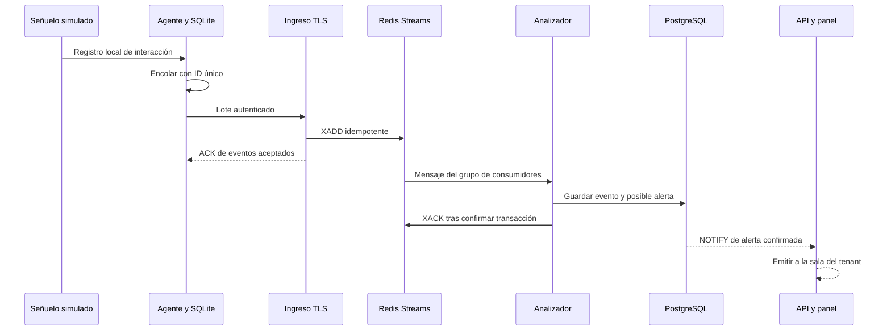
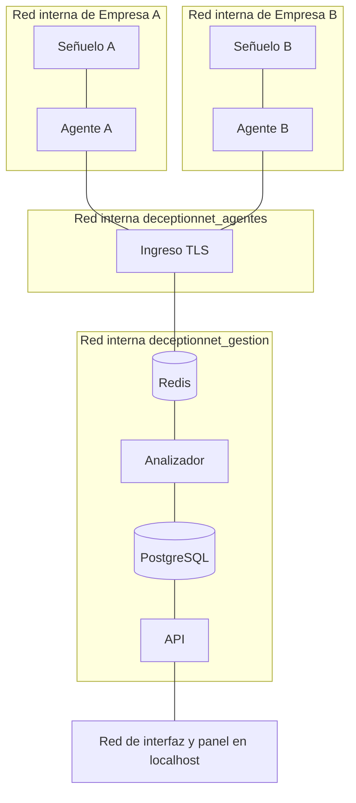
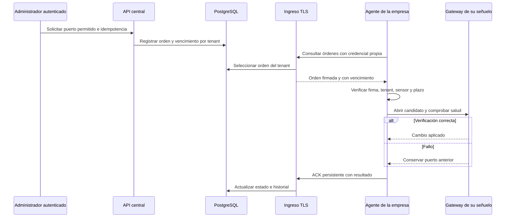

# Arquitectura de DeceptionNet en el laboratorio

La interfaz vigente se describe en `GUIA_PRESENTACION_EXTERNA.md`. El panel solo observa las pruebas iniciadas en PowerShell o en el navegador; la antigua ruta de generación de conexiones fue retirada. La API entrega métricas por identidad RLS. Eventos, alertas, decisiones y acciones MTD notifican a Socket.IO después del commit. Los intentos de acceso a los señuelos web y MySQL locales tienen reglas específicas; la rotación MTD automática sigue limitada al gateway SSH. El ingreso de agentes A/B mantiene su configuración anterior; registrar una organización no provisiona su agente.

Los diagramas describen los archivos `compose.yaml`, `compose.override.yaml`, `agentes/empresa_a/compose.yaml` y `agentes/empresa_b/compose.yaml`. A y B son empresas ficticias.

## Componentes

## Secuencia de un evento remoto

## Redes Docker

## Orden MTD remota

